# Enterprise IT & Cyber Network Lab

A hands-on networking and cybersecurity lab built in GNS3.

I started with a simple LAN and gradually expanded it into a segmented network with multiple subnets, Linux routers, NAT, a stateful firewall, an internal Web Server, and controlled HTTP/SSH access.

The main goal was to understand how traffic actually moves through a network and how routing, NAT, firewall rules, and access-control policies affect that traffic.

## Final Topology

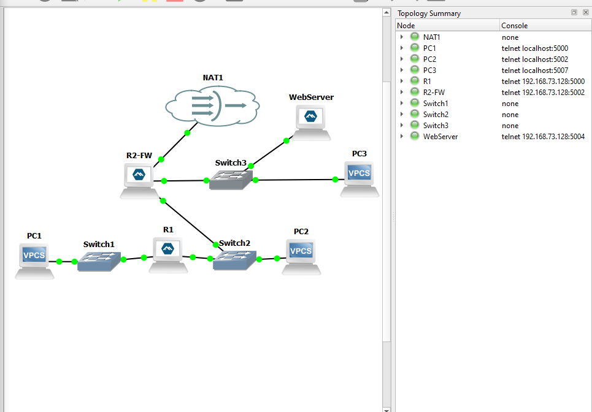

The final lab includes:

- 3 client PCs
- 2 Linux routers
- 3 Ethernet switches
- 1 internal Web Server
- GNS3 NAT for Internet access
- Stateful firewall rules on R2
- HTTP and SSH access-control policies

## Network Addressing

| Device | Interface | IP Address | Role |
|---|---|---|---|
| PC1 | Ethernet0 | `192.168.10.10/24` | Client on LAN 1 |
| R1 | eth0 | `192.168.10.1/24` | Gateway for LAN 1 |
| R1 | eth1 | `192.168.20.1/24` | Router link / middle LAN |
| PC2 | Ethernet0 | `192.168.20.20/24` | Client on middle LAN |
| R2-FW | eth0 | `192.168.20.2/24` | Internal interface |
| R2-FW | eth1 | `192.168.30.1/24` | Gateway for server LAN |
| R2-FW | eth2 | DHCP | WAN / GNS3 NAT |
| PC3 | Ethernet0 | `192.168.30.10/24` | Client on LAN 3 |
| WebServer | eth0 | `192.168.30.20/24` | HTTP / SSH server |

## 1. GNS3 Environment

The lab runs in GNS3 with the GNS3 VM hosted in VMware Workstation.

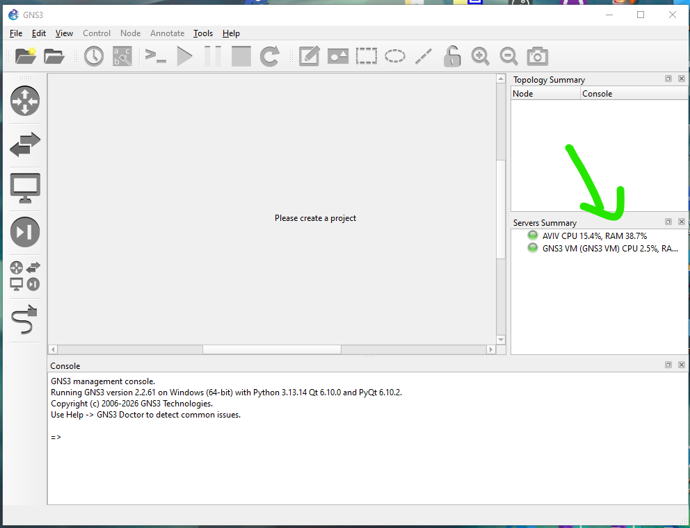

Alpine Linux was used for the routers and server, while VPCS was used for the client machines.

## 2. Basic LAN Connectivity

The project started with two hosts connected through an Ethernet switch.

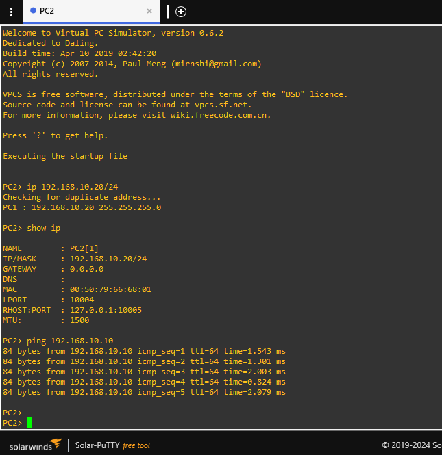

This was used to verify basic addressing and communication inside the same subnet.

## 3. ARP, ICMP and Wireshark

Wireshark was used to inspect traffic generated during a ping.

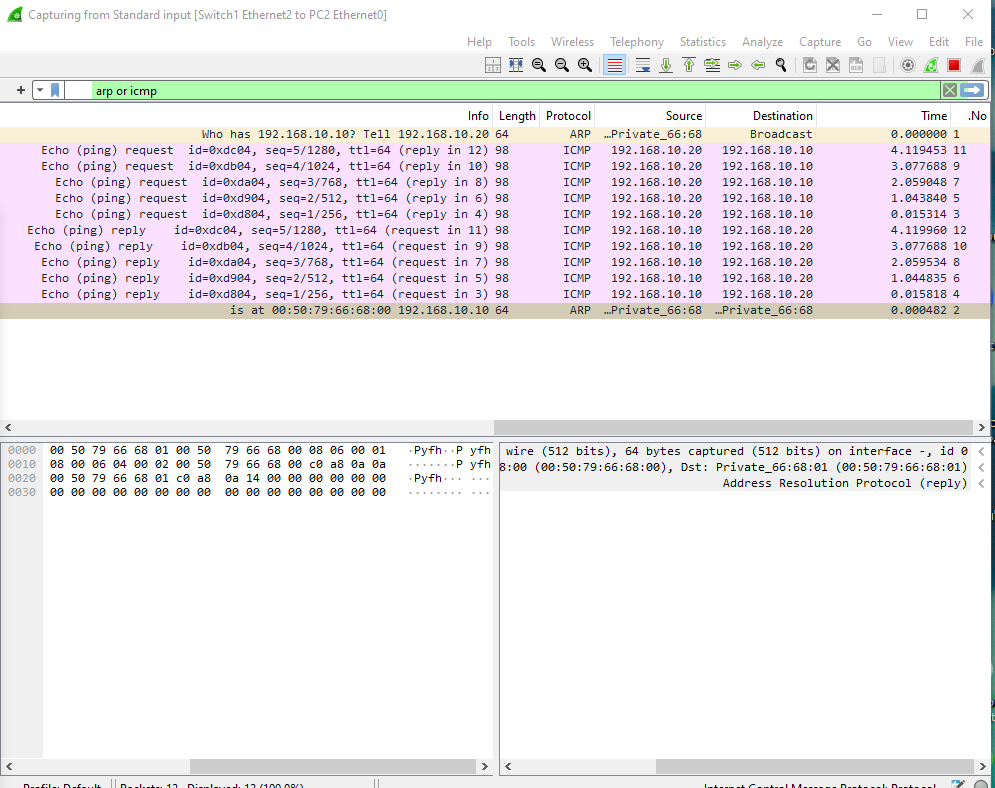

The capture showed:

- ARP requests and replies
- MAC address resolution
- ICMP Echo Requests
- ICMP Echo Replies

This helped me understand how Layer 2 and Layer 3 work together during normal communication.

## 4. Inter-Subnet Routing

An Alpine Linux router was added to route traffic between different networks.

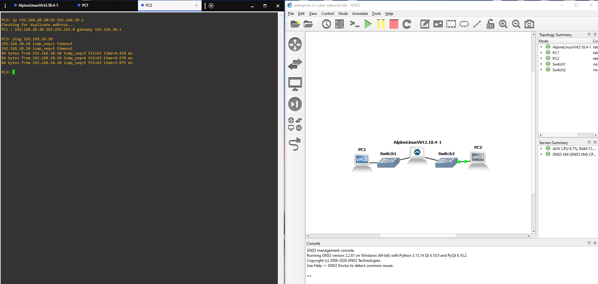

Packet captures on both sides of the router showed that the IP source and destination remained the same, while the Ethernet MAC addresses changed at each routed hop.

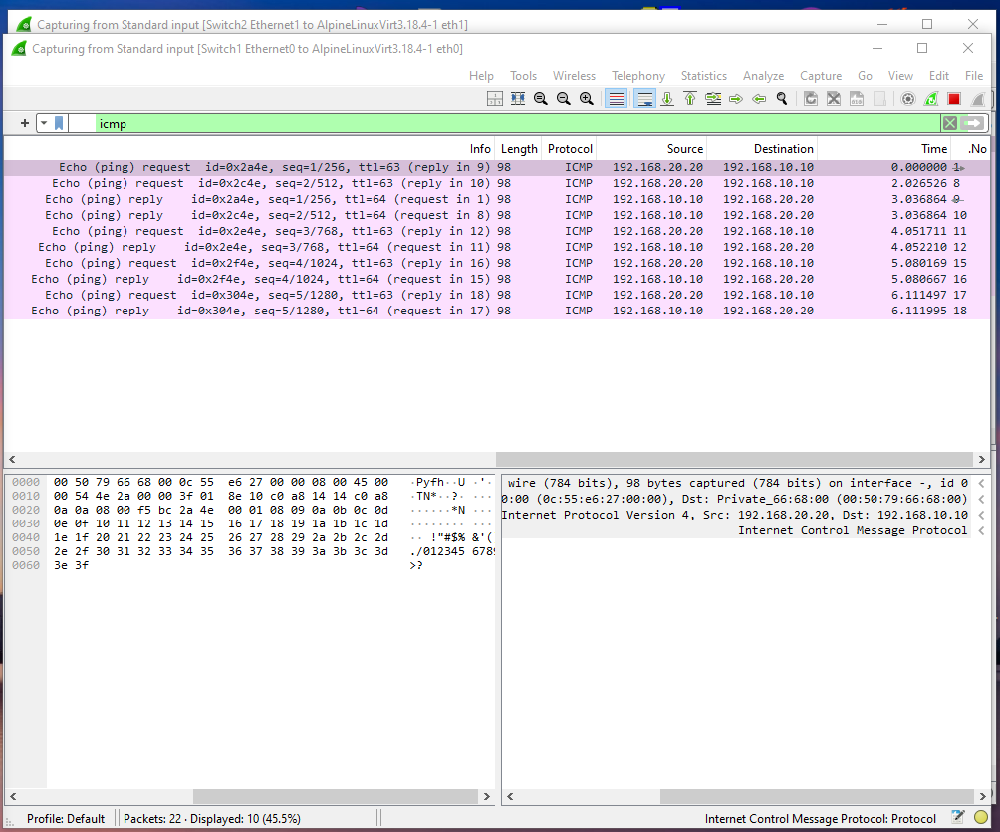

## 5. Static Routing

The topology was expanded to two routers and three internal networks.

Static routes were configured so traffic could move between LAN 1 and LAN 3.

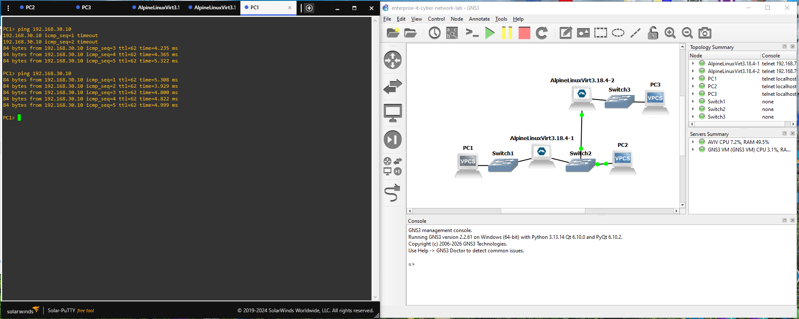

The successful ping showed a TTL of 62, confirming that the packet passed through two routers.

## 6. NAT and Internet Access

R2 was given a third interface connected to the GNS3 NAT network.

Linux IP forwarding and an iptables MASQUERADE rule were configured:

```bash
iptables -t nat -A POSTROUTING -o eth2 -j MASQUERADE
```

The NAT configuration was saved so it would survive a reboot.

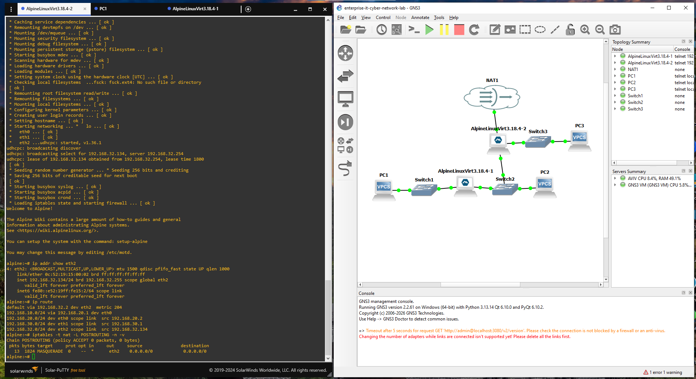

PC1 was then able to reach the Internet through R1, R2 and NAT.

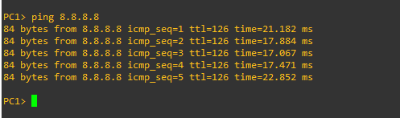

## 7. Firewall Filtering

R2 was also used as the main firewall.

A simple ICMP rule was first used to test filtering:

```bash
iptables -A FORWARD -s 192.168.10.10 -p icmp -j DROP
```

The packet counter confirmed that traffic was matching the rule.

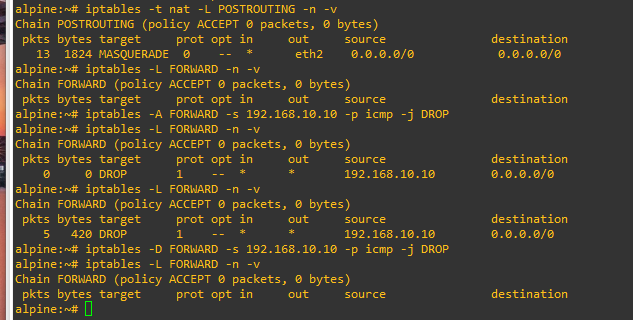

After removing the rule, connectivity returned.

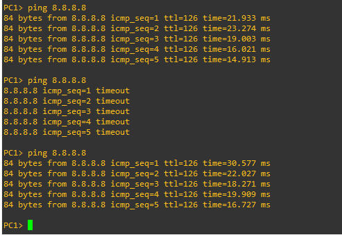

## 8. Stateful Firewall

The firewall was then changed to a default-deny design.

```bash
iptables -P FORWARD DROP
```

Return traffic from approved connections was allowed with connection tracking:

```bash
iptables -A FORWARD \
  -m conntrack \
  --ctstate ESTABLISHED,RELATED \
  -j ACCEPT
```

New outbound connections were only allowed where needed.

I also added logging for traffic that reached the end of the FORWARD chain and was blocked by the default DROP policy.

This made the firewall stateful instead of simply allowing or blocking packets without connection awareness.

## 9. HTTP Access Control

An Alpine Linux Web Server was added to the `192.168.30.0/24` network.

Web Server IP:

```text
192.168.30.20
```

Lighttpd was installed and configured to listen on TCP port 80.

Instead of allowing all traffic from LAN 1 to the server network, the firewall only allows HTTP:

```bash
iptables -I FORWARD 4 \
  -i eth0 \
  -o eth1 \
  -p tcp \
  --dport 80 \
  -m conntrack \
  --ctstate NEW \
  -j ACCEPT
```

The result:

- ICMP from PC1 to the Web Server is blocked
- HTTP on TCP/80 is allowed

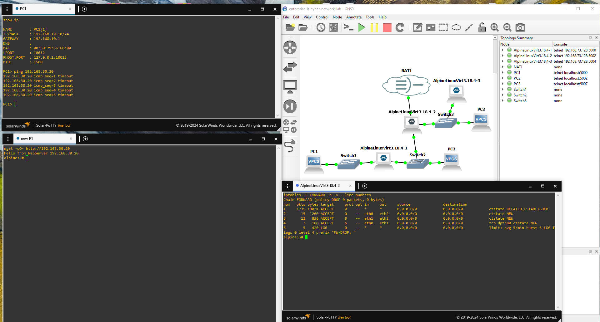

This demonstrates service-based filtering and network segmentation.

## 10. Restricted SSH Access

OpenSSH was installed on the Web Server and configured to listen on TCP port 22.

Instead of allowing SSH from the whole network, the firewall only allows R1 to initiate an SSH connection to the Web Server:

```bash
iptables -I FORWARD 5 \
  -s 192.168.20.1 \
  -d 192.168.30.20 \
  -p tcp \
  --dport 22 \
  -m conntrack \
  --ctstate NEW \
  -j ACCEPT
```

A separate `admin` account was used for SSH instead of enabling password-based root login.

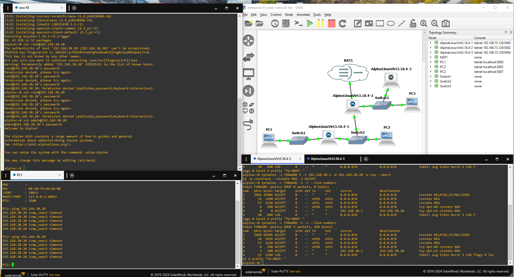

This policy restricts access based on:

- Source IP
- Destination IP
- Protocol
- Destination port
- Connection state

## Key Security Controls

The final firewall policy includes:

- Default DROP policy on forwarded traffic
- Stateful `ESTABLISHED,RELATED` handling
- HTTP allowed only on TCP/80
- SSH allowed only from R1 to the Web Server
- Logging for blocked traffic
- NAT for controlled Internet access

## Persistence

The important network and security settings were configured to survive reboots.

This includes:

- Router interface addresses
- Static routes
- Default routes
- IPv4 forwarding
- NAT rules
- Firewall rules
- Web Server IP configuration
- Lighttpd startup
- SSH server startup

## Troubleshooting

Troubleshooting was a major part of the project.

Some of the issues I worked through included:

- ARP failures
- Missing or incorrect routes
- Missing default gateways
- Interfaces not receiving traffic
- GNS3 virtual links becoming unstable after Windows sleep/resume
- DNS resolution problems
- Firewall rules disappearing after reboot
- HTTP and SSH services not starting automatically
- Understanding the difference between `timeout`, `connection refused` and `network unreachable`

Useful commands included:

```bash
ip addr
ip route
ip neigh
ping
netstat
iptables -L -n -v --line-numbers
iptables -S
dmesg
```

Wireshark was also used to verify what was actually happening on the network instead of relying only on configuration output.

## Tools Used

- GNS3
- GNS3 VM
- VMware Workstation
- Alpine Linux
- VPCS
- Wireshark
- iptables
- Lighttpd
- OpenSSH

## What I Learned

This lab gave me practical experience with:

- IPv4 addressing and subnetting
- Default gateways
- ARP and MAC addresses
- ICMP
- Inter-subnet routing
- Static routing
- TTL
- Linux IP forwarding
- NAT / MASQUERADE
- Stateful firewall rules
- Default-deny policies
- Network segmentation
- HTTP and SSH access control
- Firewall logging
- Wireshark packet analysis
- Linux network troubleshooting

## Final Result

The finished lab contains multiple internal networks with routing between them, Internet access through NAT, a stateful firewall with a default-deny policy, an internal Web Server, and separate access-control rules for HTTP and SSH.

The project started as a basic two-host LAN and gradually developed into a small segmented environment for practicing both networking and security.
